<div align="center">

<!-- ═══════════════════════════════════════════════════════════════════════════
     [ ! ] SOLO LEVELING SYSTEM HUD — HERO AWAKENING BANNER
     ═══════════════════════════════════════════════════════════════════════════ -->


<br/>

[+%E2%80%94+I+Alone+Level+Up)](https://github.com/S-Q-Ali)

<!-- Quick Guild & Live System Links -->
<p align="center">
  <a href="https://flowpost-studio.vercel.app/" target="_blank">
    
  </a>
  <a href="https://snip-vid.vercel.app/" target="_blank">
    
  </a>
  <a href="https://github.com/S-Q-Ali/S-Q-Creator-Studio/releases" target="_blank">
    
  </a>
  <a href="https://linkedin.com/in/s-qasim-ali" target="_blank">
    
  </a>
  <a href="mailto:syedqasim963@gmail.com">
    
  </a>
</p>

</div>

---

<!--SKILL-RANK:START-->
<div align="center">



<sub>⚡ <b>SYSTEM TELEMETRY:</b> Hunter Rank <b>S-Rank (Monarch)</b> in <b>Video / AI Media Tools</b> (SFIA L7 (Set strategy)) — Updated 2026-11-13 across 25 public dungeons</sub>

</div>

<details>
<summary><b>📂 [ SYSTEM LOG ] EXPAND DETAILED SFIA 8 SKILL INVENTORY &amp; EVIDENCE MATRIX</b></summary>
<br/>

> **Primary Class:** Video / Media Tooling Engineer — Automating video workflows and content tools.  
> **Authority Level:** **S-Rank (Monarch)** — **SFIA L7 (Set strategy)**

| Discipline | Hunter Rank | Resonance Index | SFIA 8 Responsibility |
|:---|:---:|:---:|:---|
| **Video / AI Media Tools** | `S-Rank (Monarch)` | `6.57` | **L7 · Set strategy** |
| **Frontend Developer** | `S-Rank (Monarch)` | `2.8` | **L6 · Initiate** |
| **Automation Engineer** | `S-Rank (Monarch)` | `2.69` | **L6 · Initiate** |
| **AI Engineer** | `S-Rank (Monarch)` | `2.36` | **L6 · Initiate** |
| **Backend Developer** | `S-Rank (Monarch)` | `2.32` | **L6 · Initiate** |
| **Full-Stack Developer** | `A-Rank (Elite)` | `1.59` | **L4 · Enable** |
| **Technical Writing** | `C-Rank (Skilled)` | `0.72` | **L3 · Apply** |

**🗡️ S-Rank Evidence Dungeons (Video / AI Media Tools):**  
[`S-Q-Ali`](https://github.com/S-Q-Ali/S-Q-Ali) · [`S-Q-Creator-Studio`](https://github.com/S-Q-Ali/S-Q-Creator-Studio) · [`flowpost-studio`](https://github.com/S-Q-Ali/flowpost-studio) · [`SnipVid`](https://github.com/S-Q-Ali/SnipVid) · [`Easy-Window`](https://github.com/S-Q-Ali/Easy-Window) · [`Portfolio`](https://github.com/S-Q-Ali/Portfolio) · [`YouTube-Creator-Tool`](https://github.com/S-Q-Ali/YouTube-Creator-Tool) · [`Mis-Clear`](https://github.com/S-Q-Ali/Mis-Clear)

<sub>_Ranks follow the Solo Leveling System hierarchy; SFIA 8 columns map the repository-derived index onto the industry-standard Skills Framework for the Information Age (levels 1–7)._</sub>

</details>
<!--SKILL-RANK:END-->

---

<div align="center">

## 🗡️ **『 SHADOW ARMY: S-RANK DUNGEON RAIDS 』**



</div>

<table align="center" width="100%">
  <thead>
    <tr>
      <th align="left">⚔️ Shadow Unit (Repository)</th>
      <th align="center">Rank</th>
      <th align="left">Core Mana / Stack</th>
      <th align="left">Dungeon Objective &amp; Capabilities</th>
      <th align="center">Portal</th>
    </tr>
  </thead>
  <tbody>
    <tr>
      <td><a href="https://github.com/S-Q-Ali/S-Q-Creator-Studio"><b>👑 S-Q-Creator-Studio</b></a></td>
      <td align="center"><code>S-RANK</code></td>
      <td><code>Python</code> · <code>FFmpeg</code> · <code>AI Media</code></td>
      <td>Bulk-download TikTok/YouTube/IG/FB video &amp; audio, reframe 9:16 shorts in Vertical Studio &amp; verify accounts.</td>
      <td align="center"><a href="https://github.com/S-Q-Ali/S-Q-Creator-Studio/releases"><b>🚀 Release</b></a></td>
    </tr>
    <tr>
      <td><a href="https://github.com/S-Q-Ali/flowpost-studio"><b>⚡ flowpost-studio</b></a></td>
      <td align="center"><code>S-RANK</code></td>
      <td><code>Dart</code> · <code>Flutter</code> · <code>Supabase</code></td>
      <td>Native Windows cross-platform scheduler &amp; publisher for YouTube Shorts, TikTok, Reels, FB &amp; LinkedIn.</td>
      <td align="center"><a href="https://flowpost-studio.vercel.app"><b>🌐 Live</b></a></td>
    </tr>
    <tr>
      <td><a href="https://github.com/S-Q-Ali/Easy-Window"><b>🛡️ Easy-Window</b></a></td>
      <td align="center"><code>S-RANK</code></td>
      <td><code>Rust</code> · <code>Win11 API</code> · <code>Systems</code></td>
      <td>Windows 11 utility detecting persistent Chrome sessions &amp; background processes wasting CPU, RAM, disk or GPU.</td>
      <td align="center"><a href="https://github.com/S-Q-Ali/Easy-Window"><b>📦 Repo</b></a></td>
    </tr>
    <tr>
      <td><a href="https://github.com/S-Q-Ali/Editor-Agent"><b>🔮 Editor-Agent</b></a></td>
      <td align="center"><code>S-RANK</code></td>
      <td><code>Python</code> · <code>LLM Agent</code> · <code>Video</code></td>
      <td>Autonomous AI video editing &amp; media pipeline agent engineered for intelligent creator workflows.</td>
      <td align="center"><a href="https://github.com/S-Q-Ali/Editor-Agent"><b>📦 Repo</b></a></td>
    </tr>
    <tr>
      <td><a href="https://github.com/S-Q-Ali/SnipVid"><b>🎬 SnipVid</b></a></td>
      <td align="center"><code>A-RANK</code></td>
      <td><code>TypeScript</code> · <code>React</code> · <code>Web</code></td>
      <td>High-precision web video clipping &amp; content extraction studio for rapid short-form production.</td>
      <td align="center"><a href="https://snip-vid.vercel.app"><b>🌐 Live</b></a></td>
    </tr>
    <tr>
      <td><a href="https://github.com/S-Q-Ali/Auto-Captions"><b>💬 Auto-Captions</b></a> &amp; <a href="https://github.com/S-Q-Ali/Vid-Automator"><b>Vid-Automator</b></a></td>
      <td align="center"><code>A-RANK</code></td>
      <td><code>TypeScript</code> · <code>Python</code> · <code>AI</code></td>
      <td>Automated AI speech-to-caption rendering &amp; headless video production pipeline automation.</td>
      <td align="center"><a href="https://github.com/S-Q-Ali/Auto-Captions"><b>📦 Repo</b></a></td>
    </tr>
  </tbody>
</table>

---

<div align="center">

## ⚡ **『 MONARCH'S ARSENAL: RUNE & TECH INVENTORY 』**

<table align="center" width="100%">
  <tr>
    <td align="center" width="25%">
      <h4>🗡️ Sovereign Core &amp; Systems</h4>
      <br/>
      <sub><b>Python • TypeScript • JS • Rust • Dart • C#</b></sub>
    </td>
    <td align="center" width="25%">
      <h4>💎 Frontend &amp; Cross-Platform</h4>
      <br/>
      <sub><b>React • Next.js • Flutter • Tailwind • HTML5 • CSS3</b></sub>
    </td>
    <td align="center" width="25%">
      <h4>🛡️ Backend, APIs &amp; Data</h4>
      <br/>
      <sub><b>Node.js • Express • FastAPI • Supabase • Mongo • SQL</b></sub>
    </td>
    <td align="center" width="25%">
      <h4>🔮 AI, Automation &amp; DevOps</h4>
      <br/>
      <sub><b>AI/ML • Automation • Git • Actions • Docker • VS Code</b></sub>
    </td>
  </tr>
</table>

</div>

---

<div align="center">

## 📊 **『 SYSTEM TELEMETRY & DAILY QUEST LOG 』**



<br/><br/>

<table align="center" width="100%">
  <tr>
    <td width="50%" align="center">
      
    </td>
    <td width="50%" align="center">
      
    </td>
  </tr>
</table>

<details>
<summary><b>🏆 [ EXPAND HUNTER HALL OF FAME ] — GITHUB TROPHY ARTIFACTS &amp; SYSTEM CODE</b></summary>
<br/>

<div align="center">
  
</div>

```typescript
// [ SYSTEM KERNEL // SHADOW MONARCH PROTOCOL ]
const shadowMonarch = {
  hunter: "Syed Qasim Ali",
  codename: "S-Q-Ali",
  rank: "S-Rank (Monarch) // SFIA Level 7",
  baseOfOperations: "Pakistan 🇵🇰",
  education: "BS Computer Science — University of Central Punjab (UCP)",

  activeDungeons: [
    "🎬 Scaling AI-Powered Video & Creator Studio Ecosystems (Python / FFmpeg / LLMs)",
    "⚡ Shipping Native Cross-Platform Creator Suites (Flutter / Dart / Supabase)",
    "🦀 Engineering Zero-Overhead Windows 11 System Utilities (Rust)",
    "🤖 Autonomous Multi-Agent Content & Browser Automation Pipelines"
  ],

  executeShadowExtraction(): string {
    return "ARISE. 🗡️";
  }
};
```

</details>

</div>

---

<div align="center">

## 🐍 **『 SHADOW EXTRACTION: CONTRIBUTION GRID 』**

<picture>
  <source media="(prefers-color-scheme: dark)" srcset="https://raw.githubusercontent.com/s-q-ali/s-q-ali/output/github-contribution-grid-snake-dark.svg">
  <source media="(prefers-color-scheme: light)" srcset="https://raw.githubusercontent.com/s-q-ali/s-q-ali/output/github-contribution-grid-snake.svg">
  
</picture>

<sub>*Every commit is extracted and absorbed into the Shadow Army.*</sub>

</div>

---

<div align="center">

## 🔮 **『 GUILD CONNECTIONS // SUMMON THE MONARCH 』**

<p align="center">
  <a href="https://linkedin.com/in/s-qasim-ali" target="_blank">
    
  </a>
  <a href="mailto:syedqasim963@gmail.com">
    
  </a>
  <a href="https://www.instagram.com/syedqasim963" target="_blank">
    
  </a>
  <a href="https://flowpost-studio.vercel.app/" target="_blank">
    
  </a>
</p>

<p align="center">
  
  
  
</p>



</div>
